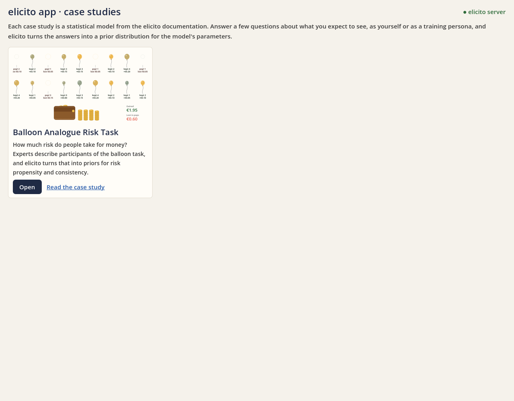
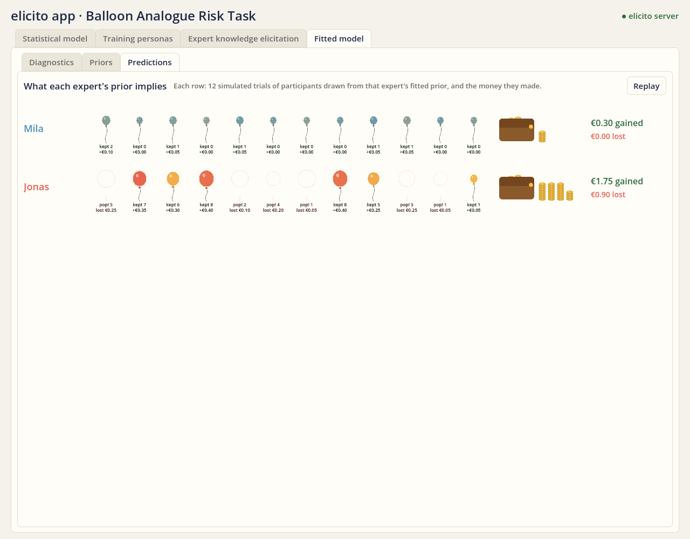

# elicito app

Interactive case studies for [elicito](https://github.com/florence-bockting/elicito),
a Python package for learning prior distributions from expert knowledge.

Pick a case study from the gallery, answer a few questions about what you
expect to see (as yourself or as a training persona), and elicito turns the
answers into a prior distribution. The app then shows whether the fit
converged, the learned prior, and what that prior implies, for one expert or
for a panel of experts.

| Gallery | Elicitation | Predictions |
|---|---|---|
|  |  |  |

The app is made with [Godot 4.7](https://godotengine.org). The fits run in
a small Python server that uses elicito.

## Run it

```bash
pip install ./server       # Python 3.11 to 3.13; installs elicito
elicito-app-server         # leave it running
```

Then open `godot/project.godot` in Godot 4.7 and press **F5** (or run an
exported build). The header shows **● elicito server** once the app is
connected.

**Without a server** (and always in the web version) the app uses
**precomputed fits**: real elicito fits, made in advance, of every training
persona and of every panel of personas. Your own answers get the fit of the
closest stored answer, and the app says so. Click **Use precomputed fits**
in the header, or start with `backend=precomputed`.

Start options (after `--` on the command line, or in the page URL of the web
build, e.g. `index.html?case=bart&embed=1`):

| Option | Meaning |
|---|---|
| `case=<id>` | open this case study directly instead of the gallery |
| `embed=1` | no way back to the gallery, for embedding in a documentation page |
| `server=<url>` | the elicito server, default `ws://127.0.0.1:8765/ws` |
| `backend=precomputed` | no server: fits made in advance (the default on the web) |

## Repository layout

```
godot/                     the app (Godot project)
  app/                     Main: header, gallery or one case study
  gallery/                 the start screen
  case_study/              CaseStudy, ExpertPersona and TargetSpec resources;
                           the tabs of one case study and how they are wired
  elicitation/             chips, personas, expert panel, fit progress
  fit/                     Fitted model: Diagnostics, Priors, Predictions
  net/                     ElicitoClient (WebSocket to the server)
  common/                  small shared widgets and the session log
  case_studies/            catalog.tres and one folder per case study
    bart/                  everything specific to the balloon task
  theme/                   app_theme.tres (made by tools/build_theme.gd)
  tests/                   GUT tests: unit/ and integration/
  addons/gut/              GUT 9.7.1, the test framework (MIT licence)
server/                    the Python server (package elicito-app-server)
.github/workflows/         CI for both parts
```

## How the app is built

The code follows the [best practices of the Godot
documentation](https://docs.godotengine.org/en/stable/tutorials/best_practices/index.html):

- **Self-contained scenes.** Each scene works wherever it is placed. What it
  needs from outside is handed in with a `setup(...)` call by its parent.
- **Call down, signal up.** Parents call methods on their children; children
  only emit signals (`fit_finished`, `play_requested`, ...). Siblings never
  talk to each other: `CaseStudyView` wires its tabs together.
- **No autoloads.** `Main` owns what all case studies share (the
  `ElicitoClient` and the training settings) and hands it down.
- **Data in resources.** A case study is a `.tres` file. Shared logic that
  needs no node lives in `static func` helpers (`QuantileMath`, `FitSummary`).
- **Static typing** throughout; files in snake_case, nodes in PascalCase,
  third-party code in `addons/`.

The flow of one fit:

```
ElicitationPage --request--> ElicitoClient --WebSocket--> elicito-app-server
       |                           |                         (elicito)
       |<------ progress, result --+
       |
       +-- fit_finished --> CaseStudyView --show_single/show_panel--> FitView
                                                          |
                                     case study's PredictionsView (e.g. balloons)
```

## Add a case study

1. **Server:** write `server/src/elicito_app_server/case_studies/<id>.py` with
   a class like `BartCaseStudy` (the elicito model, `build()`, `bounds()`,
   `simulate_draws()`, `replay()`, `mock_priors()`) and register it in
   `case_studies/__init__.py`. Add a reference test like `tests/test_bart.py`
   that checks the model against the case study in the elicito documentation.
2. **App:** make a folder `godot/case_studies/<id>/` with
   - `<id>.tres`, a `CaseStudy` (or a subclass) with the texts, questions
     (`TargetSpec`, named like the server's targets) and personas;
   - personas: a subclass of `ExpertPersona` that implements `simulate()` and
     `traits()`, and one `.tres` per persona;
   - a Predictions scene whose root extends `PredictionsView`;
   - `model.png` (see `godot/tools/latex/render_model.sh`) and `thumbnail.png`.
3. Add the `.tres` to `godot/case_studies/catalog.tres`. The tests in
   `tests/unit/test_case_studies.gd` check every case study in the catalog.
4. Make the precomputed fits for the offline and web version (below).

## Precomputed fits

The fits for the offline mode live in
`godot/case_studies/<id>/precomputed/fits.json`. Remake them when a case
study, its personas or elicito change (the test
`tests/unit/test_precomputed_fits.gd` fails when they no longer match):

```bash
godot --headless --path godot -s res://tools/export_scenarios.gd   # the answers to fit
python server/tools/precompute.py                                  # real elicito, ~5 min
```

Besides the visible personas, `CaseStudy.precompute_personas` lists hidden
experts whose answers are also fitted, so that more of the users' own
answers have a close stored fit.

## Tests

```bash
# app (from the repository root)
godot --headless --path godot --import
godot --headless --path godot -s addons/gut/gut_cmdln.gd -gexit

# server
pip install "./server[test]"
pytest server                  # fast
RUN_ELICITO=1 pytest server    # plus real elicito fits (a few minutes)
```

In the Godot editor, the GUT panel at the bottom runs the same tests.

## Licence

Apache 2.0, like elicito. GUT (`godot/addons/gut`) is MIT licensed.
